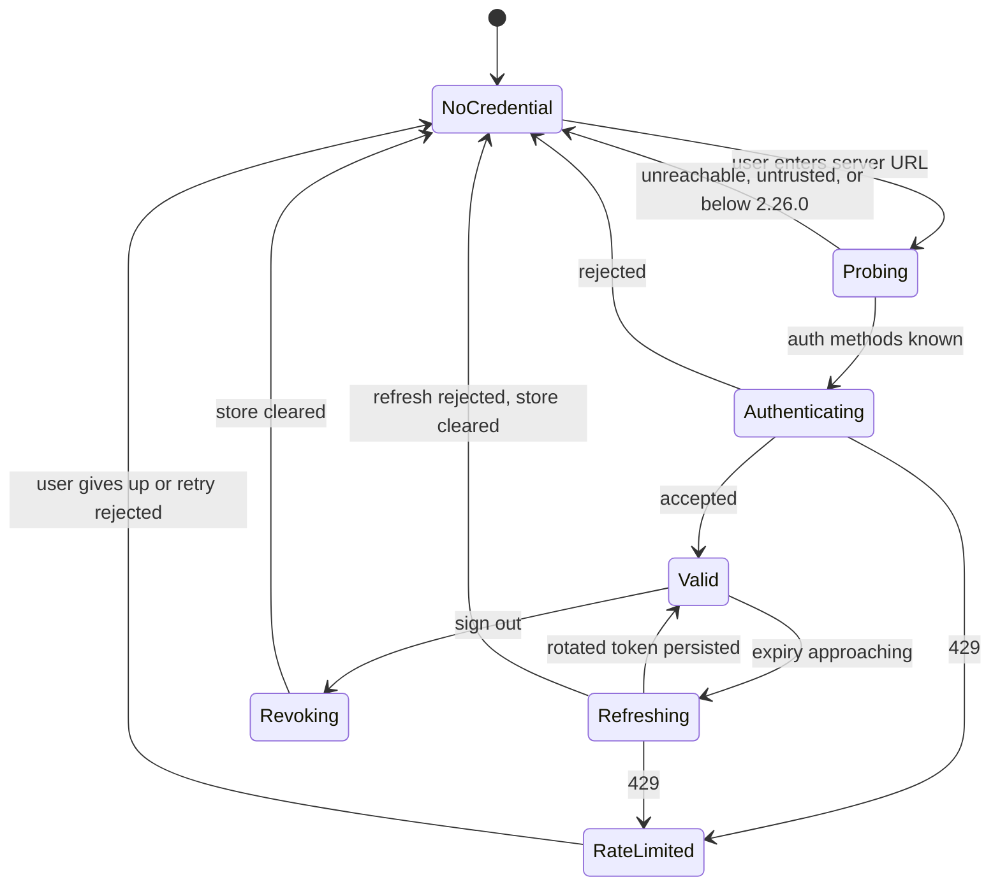

# Mini Audiobookshelf Android - Connect and auth

## Goal Capsule

- **Objective:** Sign into one Audiobookshelf server 2.26.0 or newer, persist the long-lived secret in the Android Keystore, and restore that session on relaunch. Mirror the GTK connect path: status probe first, HTTP warning, TLS pin, password or API key, rotating refresh, 429 hard stop, sign-out.
- **Authority hierarchy:** Requirements win on product behavior. KTDs win on mechanism. Phase 001 KTD1 to KTD6 still apply, especially one process and no Hilt.
- **Execution profile:** Core HTTP, models, and credential state machine first and under JUnit. Compose Connect screen second. EncryptedSharedPreferences is Android-only and is proven on a device or emulator, not in `:core:test`.
- **Stop conditions:** Stop and ask if the server's `/status`, `/login`, or `/auth/refresh` shape disagrees with the GTK client's `ApiClient` on a 2.26+ server; if EncryptedSharedPreferences cannot be created on minSdk 26 with the current security-crypto artifact; or if OkHttp cannot apply a PEM pin without turning hostname verification off.
- **Tail ownership:** Build, test, commit. No playback in this phase.

Depends on [2026-09-01-001-feat-android-scaffold-plan.md](2026-09-01-001-feat-android-scaffold-plan.md).

## Product Contract

### Summary

You type a base URL. The app probes `/status` before any secret field appears. Servers older than 2.26.0 are refused with a stated reason. Local username/password is offered only if the server lists local auth. An admin-issued API key is always offered. The long-lived credential lives in EncryptedSharedPreferences. The password never does. Access tokens refresh about 60 seconds before the expiry the server reports.

### Problem Frame

Audiobookshelf access tokens expire. Refresh tokens rotate on every use. Auth endpoints are rate-limited. The GTK client already burned the wrong designs: refresh-on-401 across concurrent calls races itself into a lockout; storing the password is unnecessary; writing the refresh token in plaintext is a bad trade when the Keystore is missing.

Android adds one more way to get this wrong. `INTERNET` is obvious. Cleartext HTTP is not. A debug build that sets `usesCleartextTraffic=true` globally makes the HTTP warning theater. Cleartext must be origin-specific after the user checks "I understand the risk."

### Requirements

**Connection**

- R1. One server at a time, identified by a base URL the user types.
- R2. Before credential fields, GET `/status` unauthenticated. Refuse `serverVersion` below 2.26.0 with copy that names the floor.
- R3. Username/password is shown only if `authMethods` contains `local`. API-key sign-in is always shown.
- R4. Plain HTTP is not silent. Before any secret is typed, the app states that password, token, audio, and cover art can be read or altered in transit, and requires checking "I understand the risk." The scheme is never upgraded for you.
- R5. Failed TLS is a pin, not a bypass. Show the SHA-256 fingerprint of the presented certificate. Pinning stores that exact certificate for that origin. Verification stays on. A later certificate change is refused, not re-prompted.

**Credentials**

- R6. Password mode stores the rotating refresh token, not the password. API-key mode stores the key. Access tokens are memory-only plus whatever short cache the credential manager needs until the next refresh.
- R7. Refresh is scheduled from the expiry the server reports, 60 seconds early. If the response has no expiry, fall back to a 10-minute access-token lifetime. Single-flight: one refresh at a time.
- R8. 429 on login or refresh stops automatic retry and shows a rate-limit message. Copy may mention a wait. No live countdown widget is required, matching the GTK app.
- R9. Account credentials travel only in request headers. No password, access token, refresh token, or API key in a URI, query string, or fragment.
- R10. HTTP logs, crash extras, and user-facing errors never include secrets or the refresh token. Authorization header values are redacted in any log line.

**Persistence and session**

- R11. The long-lived secret is in EncryptedSharedPreferences backed by the Android Keystore. The last server URL, device id, HTTP-risk acknowledgment, and pinned certificate PEM live in DataStore, not in the encrypted blob.
- R12. If the encrypted store cannot be created or a write fails, keep the credential in memory for this process and toast: "You'll need to sign in again next time." Nothing is written to disk in plaintext.
- R13. Relaunch restores the session when URL and secret both exist. Probe is not repeated on every cold start if the stored URL is still set; a failed authorized call can still send the user back to Connect.
- R14. Sign-out calls `POST /logout`, deletes the local secret, and returns to Connect. API-key sign-out warns that the key stays valid until an admin revokes it. Local clear happens even if logout fails.
- R15. `INTERNET` is the only new permission in this phase.

### Acceptance Examples

- AE1. SSO-only server
  - **Covers:** R2, R3
  - **Given:** `/status` returns 2.30.0 and `authMethods` without `local`.
  - **When:** the user finishes the URL step.
  - **Then:** there is no password field. The API-key field is there.

- AE2. Old server
  - **Covers:** R2
  - **Given:** `/status` returns 2.20.0.
  - **When:** the probe completes.
  - **Then:** credential fields are not shown. The message names 2.26.0.

- AE3. HTTP warning
  - **Covers:** R4
  - **Given:** the user typed `http://abs.lan`.
  - **When:** they try to continue.
  - **Then:** they cannot type a password until the risk checkbox is checked. The URL is still `http`, not rewritten to `https`.

- AE4. Self-signed pin
  - **Covers:** R5
  - **Given:** the server presents a certificate the system store rejects.
  - **When:** the user pins it.
  - **Then:** `/status` and later `/login` succeed against that origin. Replacing the cert on the server makes the app refuse rather than prompt again.

- AE5. Keystore failure
  - **Covers:** R12
  - **Given:** EncryptedSharedPreferences throws on create.
  - **When:** login succeeds.
  - **Then:** the session works until process death, the toast appears once, and `adb` shows no refresh token in shared_prefs plaintext.

- AE6. Rate limit
  - **Covers:** R8
  - **Given:** `/login` returns 429.
  - **When:** the app observes it.
  - **Then:** it does not immediately retry. The user sees a rate-limit message.

- AE7. API-key sign-out
  - **Covers:** R14
  - **Given:** the user signed in with an API key.
  - **When:** they sign out.
  - **Then:** they see that the key remains valid on the server until an admin revokes it, the local secret is gone, and Connect is shown.

### Scope Boundaries

**In scope**

URL entry, status probe, version floor, HTTP acknowledgment, TLS pin, password and API-key login, refresh, 429, Keystore persistence, relaunch restore, sign-out, typed API errors.

**Deferred**

OIDC in a Custom Tab. Multiple saved servers. Playback, browse, downloads. `FLAG_SECURE` on the Connect screen is not required.

**Outside**

Disabling TLS verification. Storing the password. Putting the token in the cover or stream URL. The deprecated permanent user token field.

## Planning Contract

### Threat Model

**Defended against**

- Network attacker on HTTP: R4, never silent cleartext.
- Certificate substitution after a pin: R5.
- Refresh token on disk in plaintext: R11, R12.
- Credential in a URI that Media3 or Coil will log: R9. Cover URLs in this phase do not exist yet; phase 003 must keep tokens out of Coil's URI.
- Logcat dumps of `Authorization`: R10.

**Not defended against**

Root, debuggable builds with backup enabled by a user, same-app accessibility. Backup of EncryptedSharedPreferences: set `android:allowBackup="false"` until there is a real reason to turn it on.

**Partially trusted: the server**

Chosen by the user. JSON is parsed with kotlinx.serialization that ignores unknown keys. Do not log response bodies that include tokens.

### Key Technical Decisions

- KTD1. **Reuse the GTK client's HTTP contract, ported to OkHttp.** Governs R2, R7, R9. Endpoints and headers:
  - `GET /status` unauthenticated. Read `serverVersion` and `authMethods`.
  - `POST /login` with `x-return-tokens: true`. Body `username` and `password`.
  - `POST /auth/refresh` with `x-refresh-token`. Refresh tokens are rejected on resource endpoints as of 2.36.0; do not send them as Bearer.
  - `POST /logout` with Bearer access token or API key.
  - `GET /api/authorize` after restore to validate a stored API key or access+refresh pair.
  - Minimum version `2.26.0`, same comparator as `ApiClient.compare_versions` in the GTK tree.
  - Login and refresh JSON is parsed for tokens and expiry only. Tolerate unknown fields.

- KTD2. **OkHttp is the only HTTP stack, constructed at the composition root with a trust interceptor that can swap in a pinned `HandshakeCertificates`.** Governs R5, R15. Phase 004 will play audio through `OkHttpDataSource` on this same client so a pin that works for `/login` also works for the stream. Building a second stack for ExoPlayer is how you get "API works, audio doesn't" on self-signed LAN boxes.

- KTD3. **Pins store full PEM, keyed by normalized origin, in DataStore.** Governs R5. Fingerprint-only pins push you toward a custom trust-all manager later. PEM lets OkHttp's trust manager use that exact cert as the only additional CA for that host. Hostname verification stays on. Network security config does not set a global cleartext or debug-overrides bypass.

- KTD4. **Cleartext is allowed only for the user-acknowledged origin.** Governs R4. Default `android:usesCleartextTraffic="false"`. After acknowledgment, OkHttp's connection spec permits `http` to that host. Do not flip the manifest flag for the whole app.

- KTD5. **Credential is a mode with an optional refresh path.** Governs R3, R6, R7. Password mode: access token plus rotating refresh token. API-key mode: key, no client refresh. Same `TokenProvider` interface the API client uses. Port the GTK state machine: NoCredential, Probing, Authenticating, Valid, Refreshing, RateLimited, Revoking.

- KTD6. **Refresh is proactive, single-flight, 60s before server expiry, 10-minute fallback.** Governs R7, R8. Persist the new refresh token before using the new access token. 429 is a hard stop, not exponential backoff.

- KTD7. **EncryptedSharedPreferences for the secret; DataStore for everything else; in-memory degrade on failure.** Governs R11, R12. MasterKey AES256-GCM. File name is not `credentials.xml` in world-readable prefs. If the security-crypto artifact is deprecated but still the supported Keystore wrapper at implementation time, use it; if it is gone, wrap AES-GCM with a Keystore key yourself. Never a plaintext fallback file.

- KTD8. **Device id is a UUID generated once and stored in DataStore.** Needed by phase 004's `deviceInfo`. Generate it here so playback does not have to invent storage.

- KTD9. **Injected `Clock`, `HttpTransport`, `SettingsStore`, `SecretStore` in `:core`.** Governs testability. Android implementations live in `:app`. Core tests never touch EncryptedSharedPreferences.

### High-Level Technical Design

Connect UI is a linear flow: URL, optional HTTP checkbox, optional pin dialog, then credential fields. After Valid, `AppRoot` shows a stub "Signed in" screen with a Sign out action. Library UI is phase 003.

### Assumptions

- Server behavior matches the GTK `ApiClient` against Audiobookshelf 2.36.x. Endpoint facts were not re-litigated here.
- Normalized origin is scheme + lowercased host + port, with default ports omitted.
- `INTERNET` is enough. No ACCESS_NETWORK_STATE until phase 006 cares about metered Wi-Fi.

## Implementation Units

### Unit Index

| U-ID | Title | Key files | Depends on |
|---|---|---|---|
| U1 | URL, version compare, serialization models | `:core` `ServerUrl`, `ServerStatus`, tests | none |
| U2 | OkHttp transport, status probe, typed errors | `:core` `ApiClient`, `:app` `OkHttpTransport` | U1 |
| U3 | TLS pin and cleartext policy | `:core` `TrustStore`, `:app` OkHttp TLS wiring | U2 |
| U4 | Credential manager, secret store, refresh | `:core` `Credentials`, `:app` `EncryptedSecretStore` | U2 |
| U5 | Connect UI, restore, sign-out | `ConnectScreen`, `AppRoot` branch | U3, U4 |

### U1. URL, version compare, models

- **Requirements:** R1, R2
- **Approach:** Port `compare_versions` / `version_supported` from the GTK client as pure Kotlin. `ServerUrl.parse` rejects empty input and strips trailing slashes. kotlinx.serialization with `ignoreUnknownKeys = true`.
- **Test scenarios:** 2.25.9 false, 2.26.0 true, 2.36.0 true, `2.26.0-beta` still parses the first three numeric parts the same way the Vala client does. Document that behavior in the test name.

### U2. OkHttp transport and status probe

- **Requirements:** R2, R9, R10, R15
- **Approach:** `HttpTransport` in core is an interface: method, url, headers, body, returns status and string. App implements with OkHttp. `ApiClient.probeStatus`. User-facing strings from typed errors, not exception messages that might contain the URL with a mistaken query token.
- **Verification:** Core tests inject a fake transport. No live server required.

### U3. TLS pin and cleartext

- **Requirements:** R4, R5
- **Approach:** On handshake failure, surface the cert fingerprint. User pin writes PEM into DataStore. Rebuild OkHttp client with that cert. Network security config: cleartext disabled by default.
- **Verification:** Against a local Caddy with a self-signed cert, pin once, reload, pin still works. Swap the cert, connection refused.

### U4. Credentials

- **Requirements:** R6 to R8, R11 to R14
- **Approach:** Port the GTK credential manager tests: persist refresh before access, 429, revoke-on-sign-out, degrade when `SecretStore.write` fails. Fake clock for expiry.
- **Verification:** `:core:test` covers the state machine. Emulator covers EncryptedSharedPreferences round-trip.

### U5. Connect UI

- **Requirements:** R1 to R5, R13, R14
- **Approach:** Compose screens, ViewModel talks only to `Credentials` and `ApiClient`. Sign-out control on the stub signed-in screen. Restore: Application.onCreate reads stores, if Valid skip Connect.
- **Verification:** Manual: HTTP warning, pin, password, API key, kill process, relaunch still signed in, sign out.

## Risks and Dependencies

| Risk | Impact | Mitigation |
|---|---|---|
| security-crypto deprecated or broken on target 36 | No Keystore-backed prefs | KTD7 fallback: hand-rolled Keystore AES-GCM. Still no plaintext file. |
| Pin applied to OkHttp but not later to ExoPlayer | Self-signed stream fails | KTD2. Phase 004 must use this client. |
| Cover URL with `?token=` | Token in Coil disk cache and logcat | R9. Phase 003 uses session cookies/headers, not query tokens. |
| Backup extracts EncryptedSharedPreferences | Secret leaves the device | `allowBackup=false`. |

## Open Questions

- OQ1. Exact JSON field names for token expiry on current 2.26 vs 2.36. Default: read what the GTK client reads; if both missing, 10-minute fallback. Confirm during U4 against a live server.
- OQ2. Whether `/api/authorize` is enough to restore API-key sessions without a refresh path. Default: yes.

## Sources

- GTK `src/core/api-client.vala`, `credentials` unit, features.md "Connect and sign-in".
- GTK plan KTD5, KTD6, KTD9, KTD11, KTD19.
- Audiobookshelf GHSA-798w-wv6c-2c3h: refresh token not accepted as Bearer on resource routes.
- OkHttp CertificatePinner vs full custom TrustManager: pin PEM as a trusted cert, do not call `hostnameVerifier { _, _ -> true }`.
