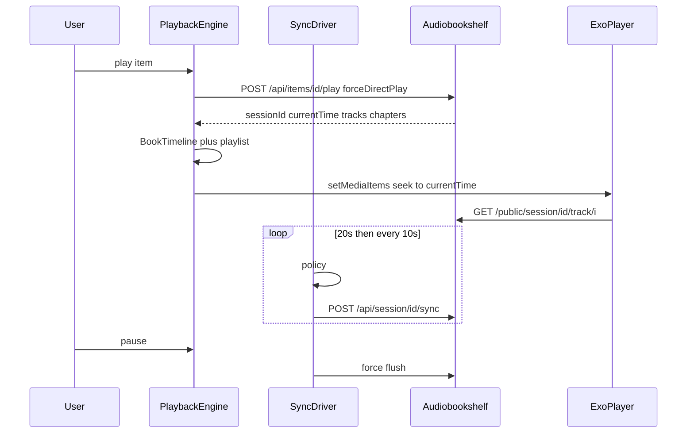

# Mini Audiobookshelf Android - Playback and sync

## Goal Capsule

- **Objective:** Open a direct-play session, stream from the unauthenticated public track URL, keep one whole-book clock, detect stalls, and write progress only through `POST /api/session/{id}/sync`. Audio continues when the Activity dies, via Media3 `MediaSessionService`.
- **Authority hierarchy:** Requirements win on product behavior. KTDs win on mechanism. Units override neither. Sync cadence and the Continue Listening trap are inherited from the GTK client and are not up for redesign.
- **Execution profile:** BookTimeline and policies in `:core` first. Engine + service in `:app` second. Wire `PlayerCommands` from phase 003. Full player chrome is phase 005; a notification and a log/toast is enough to prove this slice. A developer extra `MINI_ABS_ITEM` may start playback without tapping a tile, matching desktop's test path.
- **Stop conditions:** Stop and ask if `forceDirectPlay: true` no longer causes transcode-only items to be identifiable, if `/public/session/{id}/track/{index}` starts requiring a header, or if Media3 cannot play concatenated progressive files through `OkHttpDataSource`.
- **Tail ownership:** Implementer owns build, test, commit.

This is the phase the GTK plan ran early for the same reason: every later screen is decoration on a wrong pipeline.

---

## Product Contract

### Summary

Play means `POST /api/items/{id}/play` with `forceDirectPlay: true`. Audio is `GET /public/session/{sessionId}/track/{index}` with no Authorization. Multi-file books are one timeline. Speed is 0.5× to 3.0× with pitch held. Progress writes are session sync only, first after 20s of accumulated play, then every 10s, flush on pause/seek/stop.

### Problem Frame

Two API facts dominate. An audiobook is a list of files with offsets, so the client builds whole-book time. Progress can be written two ways, and mixing them wedges Continue Listening. A third Android fact: if ExoPlayer lives in the Activity, turning the screen off pauses the book. The engine belongs in a `MediaSessionService`.

A fourth fact from GTK, still true: putting the access token on the media URL looks convenient and then 401s mid-file when the token rotates, because the HTTP source is reused for range requests. Public session URLs exist to stop that.

### Requirements

**Session and stream**

- R1. Playing an item or episode opens a server playback session with `forceDirectPlay: true` and `deviceInfo.clientName` `Mini Audiobookshelf` plus the stable `deviceId` from phase 002. Episode play uses `/api/items/{id}/play/{episodeId}`.
- R2. If the server can only transcode, the session is closed and playback is refused with an explanation. No HLS, no transcode path.
- R3. Audio is fetched from `/public/session/{sessionId}/track/{index}` with no account credential. The session id is a limited-scope secret: never logged, never in notification extras, never in user-facing errors, never in MediaMetadata.
- R4. User-initiated play seeks to the session's `currentTime`. Finished items follow detail's Start over. Mid-playback session re-open keeps the local position (AE3).

**Timeline and transport**

- R5. Position, duration, seek, skip ±30s, and chapters use whole-book time across all tracks.
- R6. Multi-file items advance without an audible gap. Position reporting is suppressed across a track boundary so the seek bar and stall detector do not jump backward.
- R7. Speed presets: 0.5, 0.75, 1, 1.25, 1.5, 2, 2.5, 3. Pitch stays 1.0. Last rate is saved in DataStore and reapplied across tracks and sessions.
- R8. Previous chapter restarts the current chapter if more than 3 seconds in. Chapter controls are hidden when there are no chapters.

**Failures**

- R9. Stream errors that carry an HTTP status are classified. 404 on the media URL re-opens the session. Silent hung transfers: if position does not advance for 5 seconds while intended-playing, retry twice, then surface a stall with Retry. Position is preserved.

**Sync**

- R10. Writes go only through `POST /api/session/{id}/sync`. `PATCH /api/me/progress` is unused.
- R11. Cadence: first write after 20 seconds of accumulated play, then every 10 seconds, flush on pause/seek/stop, coalesced to at most one forced flush per second. Listening time is a delta. Sub-second position moves are skipped.
- R12. Sync 404: re-open once, re-point the player, seek to local position. If the new session is more than 60 seconds ahead, ask whether to keep this device or take the other. Behind is overwritten without asking.
- R13. If progress cannot be saved, audio keeps playing. A persistent "Progress isn't being saved" flag is set on `PlayerState` until a write succeeds. Phase 005 renders it; this phase must set it.
- R14. Stopping playback or process teardown: pause, flush sync, `POST /api/session/{id}/close`, wait a short bounded time (desktop used 4s). Do not leak sessions.

**Process**

- R15. Playback runs in a `mediaPlayback` foreground `MediaSessionService`. Killing the Activity does not stop audio. Intended-playing vs player-buffering are distinct, so a network hiccup does not flap the notification's play icon.

### Acceptance Examples

- AE1. Other device is ahead
  - **Covers:** R4, R10
  - **Given:** phone last knew 2h, server session returns 4h12m.
  - **When:** the user presses Play.
  - **Then:** playback starts at 4h12m.

- AE2. Session dropped mid-play
  - **Covers:** R12
  - **Given:** sync returns 404.
  - **When:** the next tick runs.
  - **Then:** one re-open, local seek, continue. Prompt only if new session is >60s ahead.

- AE3. Transcode only
  - **Covers:** R2
  - **Given:** play response is not direct play.
  - **When:** play is requested.
  - **Then:** session closed, no ExoPlayer prepare, user-visible explanation.

- AE4. Skip back across a file boundary
  - **Covers:** R5
  - **Given:** 30s into track 4.
  - **When:** skip −60s.
  - **Then:** track 3 at the correct offset, rate still applied, whole-book position correct.

- AE5. Silent stall
  - **Covers:** R9
  - **Given:** intended playing, position frozen 5s.
  - **When:** policy runs.
  - **Then:** two retries, then stalled flag, position kept.

- AE6. Credential dies while streaming
  - **Covers:** R13
  - **Given:** refresh fails permanently. Public stream still works because it has no Bearer.
  - **When:** syncs fail.
  - **Then:** audio continues, unsaved flag set.

- AE7. Activity destroyed
  - **Covers:** R15
  - **Given:** playing, user leaves the app, system kills the Activity.
  - **When:** the service remains.
  - **Then:** audio and notification continue. A new Activity attaches to the same session.

### Scope Boundaries

**In scope**

Session open/close, public stream, BookTimeline, gapless multi-file, speed, stall policy, sync policy and driver, MediaSessionService, notification with play/pause/skip, wiring detail Play, developer extras for URL/token/item.

**Deferred to 005**

Full player screen, chapter popover UI, queue, seek bar chrome. Notification may include skip; chapter skip in the notification is optional here.

**Deferred to 006**

Local files, offline sessions.

**Outside**

Transcode/HLS, Cast, Android Auto, sleep timer, volume UI.

---

## Planning Contract

### Threat Model delta

Session id in the URL path is the server's design. It will appear in reverse-proxy logs. Bound it by closing the session (R14). Never copy that URL into Logcat, Crashlytics (we will not add Crashlytics), notification extras, or `PlaybackException` messages shown to the user.

Audio decode is Media3 / ExoPlayer native code, the largest memory-unsafe surface. Verified TLS from phase 002 is the control. Restrict to audio. Do not enable extracting video tracks.

### Key Technical Decisions

- KTD1. **Public session track URL, no Bearer on media.** Governs R1, R3. Identical to desktop KTD2. `ApiClient.streamUrl(sessionId, index)` builds it. OkHttp still performs the GET so the TLS pin applies; it must not attach Authorization on `/public/` paths.

- KTD2. **Media3 ExoPlayer, `OkHttpDataSource.Factory` on the shared client.** Governs R3, R6, R15. One `ExoPlayer` owned by `PlaybackService` (`MediaSessionService`). Concatenate tracks with a playlist of `MediaItem`s, each URI a public track URL. Gapless: ExoPlayer's playlist concat for progressive files. Do not tear down the player at each track.

- KTD3. **`BookTimeline` in `:core` is authoritative for whole-book math.** Governs R5, R8. ExoPlayer's window duration should match; if it disagrees, trust `BookTimeline` for seek targets and chapter boundaries, then apply a seek to the matching `MediaItem` + position. Port desktop arithmetic. Tracks immutable for the life of a session. Re-open rebuilds the timeline on the main thread before the playlist is swapped.

- KTD4. **Single owner: `PlaybackEngine` in the service.** Governs R1, R4, R10, R14, R15. Opens/closes sessions, holds session id, holds `PlayerState`. Sync driver observes `PlayerState`; the engine does not call sync. UI and MediaSession commands enter through the engine. Nothing else constructs a timeline.

  `PlayerState` distinguishes **intended** playing from **pipeline** playing.

- KTD5. **Session sync only, same cadence as desktop.** Governs R10, R11. `sync-policy` is a pure function: inputs accumulated play, position, last synced position, last outcome, clock; outputs no-op, sync, force-flush, reopen-session, raise-conflict, mark-unhealthy, mark-recovered. Driver owns the coroutine timer. Listening delta is wall-clock spent in intended-play, matching desktop OQ1 default.

- KTD6. **Stall policy is pure in `:core`.** Governs R9. Position samples + intended state in, decision out. Engine retries. HTTP 404 on media is immediate re-open, not a 5s wait.

- KTD7. **Speed via `PlaybackParameters(speed, pitch = 1f)`.** Governs R7. Persist speed in DataStore. Re-apply after seek and after playlist change. No skip-silence.

- KTD8. **Foreground `MediaSessionService`.** Governs R15. `mediaPlayback` type. Notification from Media3's default or a thin custom layout. Metadata: title, artist, artwork; never session id, never stream URL.

- KTD9. **Play body `forceDirectPlay: true`.** Governs R2. Inspect the response for play method / transcode. If not direct, `close` and throw a typed error.

- KTD10. **Main-thread serialization of transitions.** Governs R6, R12. One transition in flight. Commands during a transition coalesce. Player listeners that fire on ExoPlayer's thread hop to the main looper before touching `PlayerState`.

### High-Level Technical Design



Track URI resolver is a single function `resolveTrackUri(session, index) -> Uri`. Phase 006 inserts a local-file branch there. Do not scatter `streamUrl` calls.

### Output Structure

```text
core/.../timeline/BookTimeline.kt
core/.../policy/SyncPolicy.kt
core/.../policy/StallPolicy.kt
core/.../models/PlaySession.kt
core/.../net/ApiClient.kt   # play, syncSession, closeSession, streamUrl
app/.../player/PlayerState.kt
app/.../player/PlaybackEngine.kt
app/.../player/SyncDriver.kt
app/.../player/PlaybackService.kt
app/.../player/PlayerCommandsImpl.kt
```

### Assumptions

- Server honors HTTP range requests. A reverse proxy that strips Range breaks seek; UX for that is deferred.
- Track list is immutable per session.
- `playMethod` / equivalent on the play response distinguishes direct vs transcode. Confirm against a current server during U3; if the field name moved, map it, do not guess HLS.
- Notification permission on API 33+: request when playback first starts, not at connect.

---

## Implementation Units

### Unit Index

| U-ID | Title | Key files | Depends on |
|---|---|---|---|
| U1 | BookTimeline | `BookTimeline.kt` | 001 |
| U2 | Play session parse and API | `PlaySession.kt`, `ApiClient.kt` | 003 models |
| U3 | Engine, ExoPlayer, service | `PlaybackEngine.kt`, `PlaybackService.kt` | U1, U2, 002 OkHttp |
| U4 | Stall policy | `StallPolicy.kt` | U3 |
| U5 | Sync policy and driver | `SyncPolicy.kt`, `SyncDriver.kt` | U3 |
| U6 | Wire Play and developer extras | `PlayerCommandsImpl.kt` | U5, 003 |

Execution order is the table. U3 can play a hardcoded item id before U6.

### U1. BookTimeline

- **Goal:** Pure math.
- **Requirements:** R5, R8
- **Approach:** Port desktop tests: single file, multi-file, seek across boundary, chapter at t, previous-chapter 3s rule, clamp. `data class Track(startOffset, duration, index)`. `fun at(bookSeconds): TrackPosition`.
- **Verification:** `:core:test` is the proof. No Android.

### U2. Play session parse and API

- **Goal:** `play`, `syncSession`, `closeSession`, `streamUrl`.
- **Requirements:** R1, R2, R3, R10
- **Approach:** JSON: session id, currentTime, duration, tracks with `contentUrl` ignored in favor of `streamUrl`, chapters, playMethod. Never log the raw body if it contains the session id; tests use fixtures. `syncSession` body `currentTime`, `duration`, `timeListened`.
- **Verification:** Parse fixture. `streamUrl` golden test. Redaction test: a helper that formats errors cannot include the id.

### U3. Engine, ExoPlayer, service

- **Goal:** Hear a book.
- **Requirements:** R1 to R8, R14, R15
- **Approach:** Service starts on play. Engine builds playlist from timeline indices. Seek: map book time → item index + ms. Rate in `PlaybackParameters`. Close session in `onDestroy` and when replacing items. Transcode refusal before `setMediaItems`.
- **Verification:** Manual: single-file m4b, multi-file book, skip across boundary, speed 1.5× pitch sounds normal, leave Activity, audio continues. `adb logcat` has no session id.

### U4. Stall policy

- **Goal:** Frozen position is not silent forever.
- **Requirements:** R9
- **Approach:** Sample on a 1s tick. 5s frozen + intended play → retry. Two retries then `Stalled`. HTTP error from ExoPlayer mapped: 404 → reopen path.
- **Verification:** Unit tests for the policy. Manual: airplane mode mid-play.

### U5. Sync policy and driver

- **Goal:** Server progress matches the phone without wedging Continue Listening.
- **Requirements:** R10 to R14
- **Approach:** Port desktop policy tests if they exist; otherwise write them from the cadence rules. Driver is a coroutine in the service. Conflict is a callback the UI in 005 will show; in this phase a dialog from the service is awkward, so expose `PlayerState.conflict` and a one-shot in U6 using a Compose dialog if an Activity is bound, else take the local position and log. Prefer showing the dialog when an Activity is bound; if not, keep local and set a flag for 005.
- **Verification:** Fake clock tests. Manual: play 25s, pause, check server position. Kill server session, confirm re-open.

### U6. Wire Play and developer extras

- **Goal:** Detail Play works. Testers can skip Connect.
- **Requirements:** R4
- **Approach:** `PlayerCommands` implementation. BuildConfig or `adb shell setprop` is messy; use extras `MINI_ABS_URL`, `MINI_ABS_TOKEN`, `MINI_ABS_ITEM`, optional `MINI_ABS_PIN` as desktop, read in Application for debug builds only. Never in release.
- **Verification:** Tap Play on a book. Debug extras start playback.

---

## Verification Contract

Phase done when timeline/sync/stall tests pass, a real book streams with notification controls after the Activity is gone, transcode-only is refused, progress appears on another client, and logcat on a play session contains no session id.

---

## Risks and Dependencies

| Risk | Impact | Mitigation |
|---|---|---|
| Second OkHttpClient for ExoPlayer | Pin bypass or missing cookies | Shared client from 002. |
| PATCH /api/me/progress "just for offline later" | Wedge Continue Listening | R10. Phase 006 uses local sessions, not this path. |
| Session id in `MediaItem.mediaId` | Leaks into dumpsys and Auto later | mediaId is library item id. Session id stays in engine memory. |
| ExoPlayer listener thread | Races, stall false positives | KTD10. |

**Dependencies:** 001 to 003. Media3 ExoPlayer, Session, UI (notification), OkHttp datasource. `FOREGROUND_SERVICE` and `FOREGROUND_SERVICE_MEDIA_PLAYBACK` and `POST_NOTIFICATIONS` in the manifest.

---

## Open Questions

- OQ1. Listening time wall-clock vs book-time at 2×. Default wall-clock, same as desktop OQ1.
- OQ2. Conflict dialog with no Activity bound. Default: keep local, set flag for 005.
- OQ3. Reverse-proxy Range failures. Default: seek fails, stall path may fire.

---

## Sources and Research

- Desktop KTD2, KTD4, KTD12, KTD14, KTD15 and features.md Playback / Progress sync.
- Public track URL: server PR #4263.
- Mixing progress paths: issues #2213, #4977.
- Cadence: official web client, copied by GTK.
- Media3 background playback: Android docs `MediaSessionService`.
