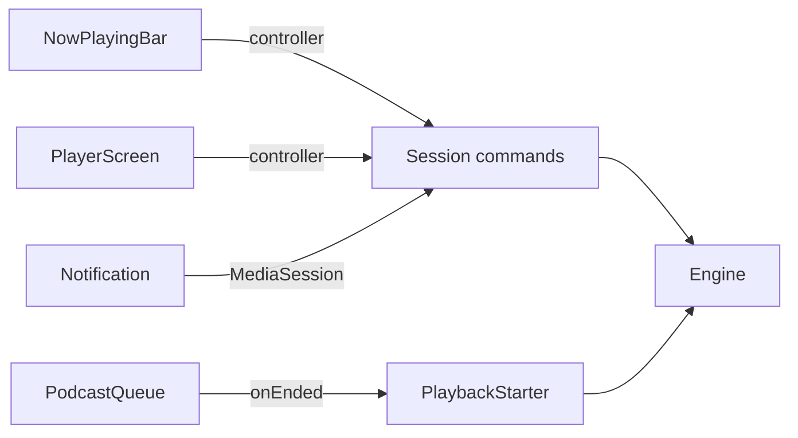

# Mini Audiobookshelf Android - Player UI and queue

## Goal Capsule

- **Objective:** Put a now-playing bar, a full player screen, and a podcast episode queue on top of the phase 004 engine. Notification and lock-screen controls already exist; this phase makes them match the in-app transport and shows stall / unsaved-progress / Retry where a person can tap them.
- **Authority hierarchy:** Requirements win. Do not add a second ExoPlayer or a second seek path. Phase 004 `PlayerState` is the only clock.
- **Execution profile:** Queue model in `:core` first, then bar and full player, then queue UI, then notification metadata polish. No new HTTP except whatever queue playback already uses through the engine.
- **Stop conditions:** Stop and ask if connecting a `MediaController` from two composables duplicates playback; if chapter skip cannot be expressed as a session custom command; or if a design wants a floating mini window, which Android should not copy from GTK.
- **Tail ownership:** Build, test, commit.

Depends on [2026-09-01-004-feat-android-playback-sync-plan.md](2026-09-01-004-feat-android-playback-sync-plan.md).

## Product Contract

### Summary

Once an item is loaded, a bottom bar shows cover, title or current chapter, play/pause, and a route into the full player. The full player has seek, skip ±30s, chapter skip when chapters exist, a chapter list, speed presets, and status lines. Podcasts can be queued. There is no book queue. There is no separate mini-player window.

### Problem Frame

The GTK mini player is a second `Adw.Window` because a desktop user wants cover-forward chrome while the library window hides. On a phone that pattern is the now-playing bar plus a full-screen player plus the system notification. Cloning the floating window gets you Picture-in-Picture for audio, which is the wrong API and fights the MediaSession.

The GTK player bar hides chapter skip, skip, chapters, and speed below 500sp. On a phone those controls belong on the full player, not jammed into a 72dp bar. The bar stays small on purpose.

### Requirements

**Now-playing bar**

- R1. Shown whenever `PlayerState` has an item. Cover, current chapter title if any else item title, play/pause, tap opens the full player.
- R2. The bar sits above the navigation content on library and detail. It does not cover the sign-out control in a way that makes sign-out unreachable.
- R3. Stall, unsaved-progress, and Retry are visible on the bar when the full player is not showing. If both are showing, do not duplicate three banners; the full player takes them.

**Full player**

- R4. Cover, title, author or show name, seek bar with elapsed/duration in whole-book time, play/pause, skip ±30s, previous/next chapter hidden when there are no chapters, chapter list with the current chapter marked, speed menu with the phase 004 presets.
- R5. Seek and skips call the engine through the `MediaController` / session commands, not by poking ExoPlayer from the composable.
- R6. Back from the full player returns to the previous screen. Playback continues. Swiping the player away is not stop.
- R7. Previous chapter uses the existing 3-second restart rule in `BookTimeline`.

**Queue**

- R8. Episodes only. Add from a show's episode rows or episode detail. Duplicates and the currently playing episode are blocked.
- R9. An "Up next" list shows title and show. Reorder, remove, skip to a row, play immediately, or clear.
- R10. When the current episode finishes, the next queued episode starts through the same engine open path as a user tap.
- R11. The queue control is available while a podcast is playing or the queue is non-empty. Sign-out and reconnect clear the queue. There is no book queue.

**System chrome**

- R12. Notification and lock screen show title, artist, cover if loaded, play/pause, skip ±30s. Next/previous map to chapters when chapters exist, otherwise they may be hidden rather than skipping tracks in a multi-file book, which would desync whole-book time.
- R13. Speed changes in-app update `PlaybackParameters` and persist as in phase 004. Notification does not need a speed affordance.

### Acceptance Examples

- AE1. Bar then full player
  - **Covers:** R1, R4, R6
  - **Given:** a book is playing on the library grid.
  - **When:** the user opens the bar, seeks, presses back.
  - **Then:** they are on the library again, audio is still going, the bar reflects the new position.

- AE2. No chapters
  - **Covers:** R4, R12
  - **Given:** an item with an empty chapter list.
  - **When:** the full player and notification are shown.
  - **Then:** chapter skip controls are absent, not disabled grey. Seek still spans the whole book.

- AE3. Queue advance
  - **Covers:** R8, R10
  - **Given:** episode A playing, B queued.
  - **When:** A reaches the end.
  - **Then:** B opens a new session and starts. A is not left as a second player.

- AE4. Duplicate blocked
  - **Covers:** R8
  - **Given:** B is already in the queue.
  - **When:** the user taps add on B again.
  - **Then:** the queue is unchanged. A short confirmation is enough; no crash.

- AE5. Sign-out clears queue
  - **Covers:** R11
  - **Given:** a non-empty queue.
  - **When:** the user signs out.
  - **Then:** the queue is empty. Signing into the same server does not restore it.

- AE6. Unsaved progress on the bar
  - **Covers:** R3
  - **Given:** sync is unhealthy per phase 004.
  - **When:** the user is on the library with the bar visible.
  - **Then:** "Progress isn't being saved" is on the bar with Retry if stall/retry applies.

### Scope Boundaries

**In scope**

Bar, full player, chapters, speed UI, queue model and UI, notification command mapping, status copy.

**Deferred**

Sleep timer, bookmarks, per-book speed, Android Auto browse tree, volume slider, equalizer, car Bluetooth chapter customizations beyond MediaSession.

**Outside**

A GTK-style second window. Picture-in-Picture. Book queues.

## Planning Contract

### Key Technical Decisions

- KTD1. **One `MediaController` in the Activity, handed to bar and full player.** Governs R5. Do not create a controller per composable. The service remains the player owner.

- KTD2. **Custom session commands for skip ±30s and chapter previous/next.** Governs R12. Standard `ACTION_SKIP_TO_NEXT` on a multi-period Media3 timeline would skip a file, not a chapter. Map notification next/previous to those custom commands when chapters exist. When they do not, omit the actions.

- KTD3. **Queue is an in-memory list in `:core`, owned by a `PodcastQueue` type, not Room.** Governs R8 to R11. Sign-out already wipes it. Surviving process death is nice-to-have: a small DataStore JSON is allowed but not required in this phase. Do not persist across sign-out.

- KTD4. **Queue advance is observed from `PlayerState` playback ended, then `PlaybackStarter` for the next episode.** Governs R10. The engine stays unaware of the queue. That keeps book playback free of podcast policy, same layering as GTK.

- KTD5. **Full player is a destination on the existing back stack, not a Dialog that eats the library.** Governs R6. Dialogs make deep detail + player + queue nested and miserable.

- KTD6. **Cover on the notification uses a bitmap loaded through Coil/OkHttp, never a URL that contains the session id.** Governs phase 004 R4.

### High-Level Technical Design

`AppRoot` layout: `Scaffold` bottomBar = `NowPlayingBar` if item != null. Nav host: library, detail, `PlayerScreen`, `QueueSheet` as a modal bottom sheet from bar or player.

### Assumptions

- Phase 004 already publishes chapter index, rate, stall, and sync health on `PlayerState`.
- Compose Material 3 bottom sheet is acceptable for Up next. A full screen queue is fine if the sheet gets cramped; pick one in U3 and stay there.

## Implementation Units

### Unit Index

| U-ID | Title | Key files | Depends on |
|---|---|---|---|
| U1 | PodcastQueue in core | `:core` queue + tests | none |
| U2 | Now-playing bar and status | `NowPlayingBar` | none |
| U3 | Full player screen | `PlayerScreen` | U2 |
| U4 | Queue UI and add buttons | show/episode detail, sheet | U1 |
| U5 | Notification command mapping and artwork | service | U3 |

### U1. PodcastQueue

- **Requirements:** R8, R11
- **Tests:** add, reject duplicate, reject current id, reorder, remove, clear, peek next, sign-out clear.

### U2. Bar

- **Requirements:** R1 to R3
- **Verification:** Appears on play, updates title on chapter change, Retry visible on stall.

### U3. Full player

- **Requirements:** R4 to R7
- **Verification:** Seek, skip, speed, chapter list jump, hide chapter controls, back keeps audio.

### U4. Queue UI

- **Requirements:** R8 to R11
- **Verification:** Add from show, add from episode detail, skip to row, clear, auto-advance.

### U5. Notification

- **Requirements:** R12, R13
- **Verification:** Lock screen skip 30s, next chapter on a chaptered book, no next-track-as-file on a multi-file book without chapters.

## Risks and Dependencies

| Risk | Impact | Mitigation |
|---|---|---|
| SKIP_TO_NEXT advances a file | Whole-book time jumps a chapter-worth the wrong way | KTD2 |
| Queue inside the engine | Books inherit podcast policy | KTD4 |
| Two controllers | Dual play commands | KTD1 |

## Open Questions

- OQ1. Persist queue across process death but not sign-out. Default: in-memory only for this phase.
- OQ2. Compact bar vs always showing skip on tablets. Default: bar stays play/pause plus title; skips live on the full player.

## Sources

- `features.md` Player bar, Podcast queue, Mini player, Desktop integration.
- GTK plan 002 mini-player: restore vs quit distinction, status must remain visible. Android translation: bar + notification, not a second window.
- Phase 004 custom command need for ±30s vs Media3 default seek increments.
