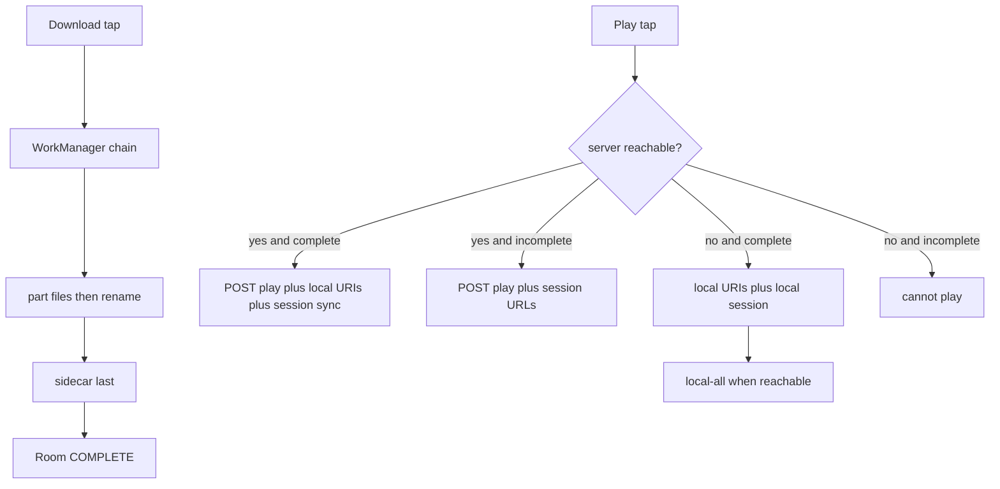

# Mini Audiobookshelf Android - Download and offline

## Goal Capsule

- **Objective:** Let the user download chosen books and podcast episodes, play them with no network, and push listening time back through Audiobookshelf local sessions when the phone is online again. Streaming stays the default.
- **Authority hierarchy:** Requirements win on product behavior. KTDs win on mechanism. Units override neither. Phase 004 still owns live-session sync. This plan must not introduce `PATCH /api/me/progress`.
- **Execution profile:** Depends on 004 and 005. Catalog and resolver in `:core`. WorkManager and files in `:app`. Hook the track-URI seam 004 reserved.
- **Stop conditions:** Stop and ask if item file download endpoints now require a query token, if `POST /api/session/local-all` rejects UUIDv4 ids, or if `user.permissions.download` is false and the server still 200s file downloads, which would mean the permission is display-only.
- **Tail ownership:** Implementer owns build, test, commit.

Desktop deferred this because a live session was mandatory. The URI seam was the cheap part. The expensive part is progress without a server session. That is this file.

---

## Product Contract

### Summary

Download is opt-in per book or episode. Files go to app-specific storage. A book is playable only when every audio file plus a sidecar of timeline metadata are present. Offline, those files play. Online, even local files open a live playback session so phase 004 sync still applies. If the network is gone, a local session is recorded and uploaded later.

### Problem Frame

Public track URLs die with the playback session, about 36 hours. They are the wrong download source. The right source is the authenticated item file endpoint, the same bytes the server would stream, pulled once with a Bearer header and stored without that header.

`PATCH /api/me/progress` would look like the offline shortcut. It is how Continue Listening gets duplicate rows. Official mobile apps use local playback sessions. So do we.

### Requirements

**Selection and permission**

- R1. The user picks books or episodes to download. Nothing is downloaded because it appeared in continue listening.
- R2. If `user.permissions.download` is false, download controls are hidden and no download API call is made.
- R3. Transcode-only items cannot be downloaded. Same refusal as play.

**Transfer**

- R4. Audio is fetched from authenticated library-item file URLs, not `/public/session/...`. Authorization in headers only.
- R5. Multi-file books are one job. Partial books are not playable. Crash or cancel leaves incomplete files and a failed/paused status, not a half-playable title.
- R6. Work runs in the background with a progress notification. Pause, cancel, retry, delete are supported. Default constraint: unmetered network. The user can allow metered in a setting.
- R7. Cover JPEG is stored next to the audio so offline tiles and the player have art.

**Storage**

- R8. Files live in app-specific external storage (`getExternalFilesDir`), not the public Downloads collection, not shared storage. Uninstall removes them. Other apps do not index them as music.
- R9. Delete removes audio, cover, sidecar, and catalog row. Sign-out asks whether to also delete downloads. Default on that dialog is keep files, drop the session. Playing downloaded audio while signed out is refused.

**Playback**

- R10. Track URI resolution: if a complete local file exists for that track, use `file://` / `Uri.fromFile`; else use the public session URL. One function, the seam from 004.
- R11. When the network is reachable at play time, open a live server session as in 004 even if every byte is local. Sync uses that session. Audio does not need the network.
- R12. When the network is not reachable and the item is fully downloaded, play anyway. Do not call `/play`. Record a local playback session.
- R13. Local sessions use UUIDv4 ids. While offline, position and `timeListened` accumulate on disk. When connectivity returns, upload via `POST /api/session/local-all` with full session objects. After a successful upload, those local rows are marked synced. Never `PATCH /api/me/progress`.
- R14. Offline library: downloaded items remain reachable from a Downloads entry or filter when the home query fails. Empty downloads plus no network is an honest empty state, not a retry spinner that cannot succeed.

**Integrity**

- R15. Sidecar stores track order, durations, offsets, chapters, item id, episode id, content hashes or byte sizes if the server provides them. On play, if a file size does not match, mark the download failed and refuse play.

### Acceptance Examples

- AE1. Book with three files
  - **Covers:** R5, R10
  - **Given:** files 1 and 2 finished, 3 at 40%.
  - **When:** the user taps Play.
  - **Then:** the item does not start. Status shows incomplete. Streaming may still run if the network is up; mixing one local track and two live tracks in one book is forbidden. All local or all streamed.

- AE2. Airplane mode, complete download
  - **Covers:** R12, R13
  - **Given:** a finished download, airplane mode.
  - **When:** the user plays and listens 12 minutes, then reconnects.
  - **Then:** audio worked offline. After reconnect, server progress includes those 12 minutes via local-all. Continue Listening is not wedged.

- AE3. Wi-Fi only
  - **Covers:** R6
  - **Given:** default settings, on cellular.
  - **When:** the user taps Download.
  - **Then:** the job waits for unmetered. A status says so. They can toggle allow-metered and retry.

- AE4. No download permission
  - **Covers:** R2
  - **Given:** `permissions.download` false.
  - **When:** detail is shown.
  - **Then:** no download button.

- AE5. Online play of a download
  - **Covers:** R11
  - **Given:** complete local files, network up.
  - **When:** Play.
  - **Then:** `/play` is called, ExoPlayer reads local URIs, sync ticks hit `/api/session/{id}/sync`.

- AE6. Sign-out
  - **Covers:** R9
  - **Given:** downloads on disk.
  - **When:** sign out.
  - **Then:** a dialog: keep downloads or delete. Keep: files remain, play is refused until sign-in. Delete: catalog empty.

- AE7. Session URL not used for download
  - **Covers:** R4
  - **Given:** a download job.
  - **When:** inspecting requests.
  - **Then:** no `/public/session/` GET. File GETs carry Authorization.

### Scope Boundaries

**In scope**

Per-item download, pause/cancel/delete, Wi-Fi default, sidecar, resolver, online-local hybrid play, offline play, local-all flush, downloads list, sign-out wipe prompt, permission check.

**Deferred**

Smart download of continue-listening, download-on-connect for queued episodes, SD card picker, Android Auto offline browse, encryption at rest beyond filesystem uid isolation, transcode-for-size.

**Outside**

Exporting files to the music library. Sharing `.m4b` via ACTION_SEND as a first-class feature. Using Media3 `DownloadManager` for HLS.

---

## Planning Contract

### Threat Model delta

Downloaded audio is the user's library in clear bytes in app storage. Any app with the same uid, a backup without encryption, or root can read it. That matches "we are not defending against the same user." Do not add a second copy in public Downloads.

Bearer tokens on download requests follow phase 002 redaction. Range requests for resume must not put the token in the URL.

Local session objects include item ids and positions, not account passwords. They still go out in local-all; treat them as listening history.

### Key Technical Decisions

- KTD1. **Authenticated file download, not session tracks.** Governs R4, R7. Endpoint shape to confirm at implementation against server source, expected: `GET /api/items/{itemId}/file/{ino}` or the current file-id equivalent on the expanded item's `AudioFile` / `LibraryFile`. Use the inodes/ino from the expanded item. Cover: existing cover URL with the shared client, saved to disk.

- KTD2. **WorkManager, one chain per item.** Governs R5, R6. Each track is a work step; the chain succeeds only if all steps succeed. `ExistingWorkPolicy.KEEP` for the same item id. Foreground info on the worker. Constraints: `NetworkType.UNMETERED` unless the setting says otherwise. Do not run WorkManager in a separate process.

- KTD3. **Catalog in a small Room database in `:app`.** Governs R8, R14, R15. Rows: item id, episode id, status, bytes, file paths, sidecar path, updated at. `:core` sees an interface `DownloadCatalog`. Tests fake it. Room is an Android dependency, so it stays in `:app`.

- KTD4. **All-local or all-stream per play, never mixed tracks.** Governs R5, R10, AE1. Resolver returns a full list of local URIs only when the catalog says COMPLETE. Otherwise the engine uses session URLs for every track.

- KTD5. **Live session when online, local session when offline.** Governs R11, R12, R13. Connectivity via `ConnectivityManager` plus a failed `/status` or failed `/play` as the real signal. Captive portal that "has network" but cannot reach the server counts as offline for play.

- KTD6. **Local-all, UUIDv4, full objects, no me/progress.** Governs R13. Advplyr: ids must be UUIDv4; the same id upserts. Flush on reconnect, on sign-in, and when a local play pauses. Batch. Failures stay queued.

- KTD7. **Wi-Fi default.** Governs R6. Audiobooks are large. Cellular surprise is worse than a delayed download.

- KTD8. **Sidecar JSON written last, after all audio files rename from `.part`.** Governs R5, R15. COMPLETE is defined as sidecar present. Play reads sidecar, not the server, when offline.

### High-Level Technical Design



### Output Structure

```text
core/.../download/DownloadCatalog.kt
core/.../download/DownloadPolicy.kt
core/.../player/TrackUriResolver.kt
app/.../download/DownloadDatabase.kt
app/.../download/DownloadWorker.kt
app/.../download/DownloadRepository.kt
app/.../download/LocalSessionStore.kt
app/.../download/LocalSessionFlush.kt
app/.../ui/download/DownloadsScreen.kt
```

### Assumptions

- Expanded item payloads include per-file ids and sizes sufficient to download and verify.
- `user.permissions.download` is on `/login` and `/api/authorize` user objects.
- local-all accepts a list of playback session objects as in server 2.9+ behavior cited by ShelfPlayer discussions. Confirm field names against current server source during U4; the published API reference is stale.

---

## Implementation Units

### Unit Index

| U-ID | Title | Key files | Depends on |
|---|---|---|---|
| U1 | Catalog interface, statuses, sidecar schema | `DownloadCatalog.kt`, tests | 004 timeline |
| U2 | File workers and storage | `DownloadWorker.kt`, `DownloadRepository.kt` | U1, 002 OkHttp |
| U3 | Resolver and engine wiring | `TrackUriResolver.kt`, engine hook | U2, 004 KTD resolver |
| U4 | Offline play and local sessions | `LocalSessionStore.kt`, `LocalSessionFlush.kt` | U3 |
| U5 | UI: buttons, downloads list, sign-out prompt | `DownloadsScreen.kt`, detail buttons | U4, 005 |

### U1. Catalog and sidecar

- **Goal:** Pure rules for complete vs partial, all-local vs stream.
- **Requirements:** R5, R10, R15
- **Approach:** Status enum: `Queued`, `Running`, `Paused`, `Failed`, `Complete`. `DownloadPolicy.canPlayOffline`. Sidecar fields listed in a data class. Tests: missing sidecar → not complete; size mismatch → not playable.
- **Verification:** `:core:test`.

### U2. Workers and storage

- **Goal:** Bytes on disk.
- **Requirements:** R1–R8
- **Approach:** Directory `abs-downloads/{itemId}/` or `{itemId}_{episodeId}/`. Files named by index. `.part` then rename. Worker reads token from `TokenProvider` at start, not persisted into WorkManager input data. Input data is item id only.
- **Verification:** Manual one-file episode, three-file book, cancel, retry, airplane during download. `adb shell ls` the external files dir. Logcat has no Authorization.

### U3. Resolver and engine

- **Goal:** Play uses local URIs when complete.
- **Requirements:** R10, R11, AE1
- **Approach:** Replace 004's `streamUrl` calls with `TrackUriResolver`. Engine asks catalog. Mixed state never produces a mixed playlist.
- **Verification:** Complete download, Wi-Fi on: tcpdump or OkHttp log shows `/play` and `/sync` but not track GETs. Incomplete: track GETs, no file://.

### U4. Offline play and local sessions

- **Goal:** AE2.
- **Requirements:** R12, R13
- **Approach:** If `/play` cannot run, and catalog complete, engine builds timeline from sidecar, sets playlist to file URIs, creates a local session row. Position ticks update the row. Flush worker on network callback. Parse local-all errors; 4xx on one session should not drop the others if the API is all-or-nothing. If all-or-nothing, keep all queued.
- **Verification:** Core tests for session object shape. Manual airplane listen, reconnect, check another client.

### U5. UI

- **Goal:** Humans can run the above.
- **Requirements:** R1, R2, R6, R9, R14
- **Approach:** Download / downloading percent / downloaded / delete on book and episode detail. Downloads screen from the library top bar. Sign-out dialog. Metered toggle in a tiny settings sheet; do not build a settings app. Unmetered-waiting copy on the row.
- **Verification:** Permission-false user if available. Sign-out keep vs delete. Offline open Downloads and play.

---

## Verification Contract

Phase done when a multi-file book downloads on Wi-Fi, refuses play while partial, plays in airplane mode, flushes progress after reconnect without me/progress, and online play of a download still uses session sync. `:core:test` covers policy. No session track URLs in download workers.

---

## Risks and Dependencies

| Risk | Impact | Mitigation |
|---|---|---|
| Downloading session URLs | Files 404 after 36h | KTD1. |
| me/progress for offline | Wedge Continue Listening | KTD6. |
| Token in WorkManager input | Secret in JobScheduler dumps | Item id only in input. |
| Mixed local/remote tracks | Seek bugs, stall, missing audio | KTD4. |
| WorkManager isolated process | Second refresh-token writer | Default process. |

**Dependencies:** 004–005. WorkManager, Room, ConnectivityManager. Confirm file endpoint and local-all against Audiobookshelf server source at implement time; do not trust api.audiobookshelf.org.

---

## Open Questions

- OQ1. Storage cap or warning at N GB. Default: none for v1, show bytes on the Downloads screen.
- OQ2. Auto-delete finished books after a week. Default: no.
- OQ3. Exact file URL field names. Default: read from expanded item during U2; stop if absent.

---

## Sources and Research

- Desktop scope: first GTK plan deferred offline; U13 reserved a URI seam; `features.md` still lists offline as deferred on desktop.
- Local sessions: server discussion on `/api/session/local` and `/local-all`, UUIDv4 requirement (advplyr, v2.9.0 era). Re-read server source in this phase.
- Continue Listening corruption: issues #2213, #4977.
- Official app download pain: long-running Android download rewrite PRs. Prefer boring WorkManager chains over a custom pool.
- AFinity's ABS download worker is prior art for "serialize a session sidecar, WorkManager, local_ prefix" but local ids must be UUIDv4 now, not `play_local_`.
