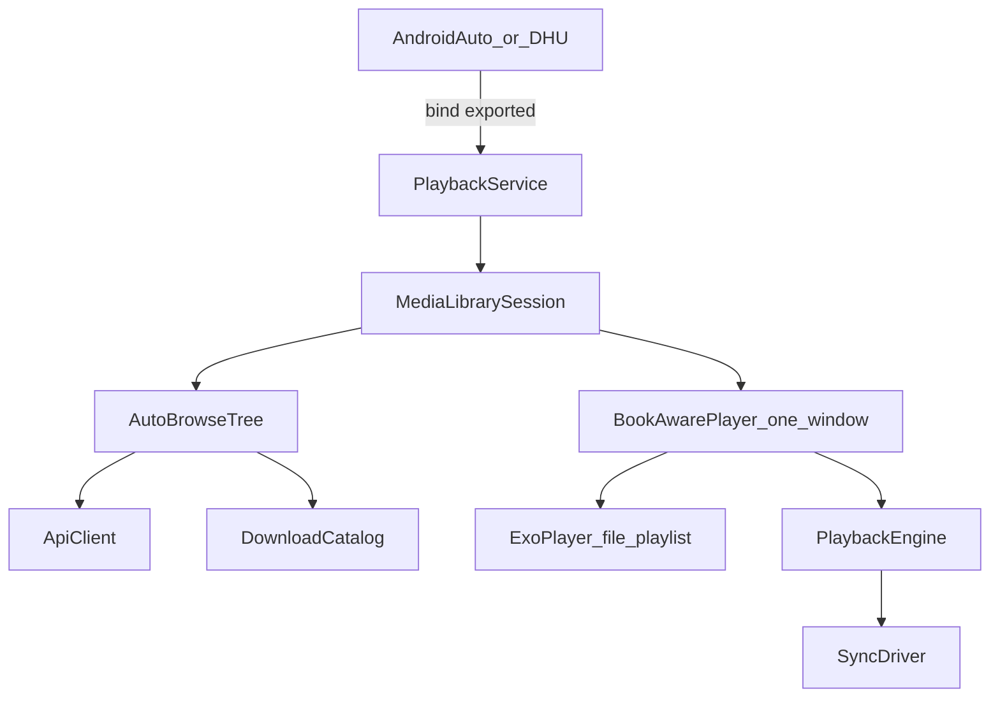

# Mini Audiobookshelf Android - Android Auto

## Goal Capsule

- **Objective:** Let a signed-in user browse continue listening and downloads on a car screen, start playback, and drive the existing engine from Android Auto and the steering wheel. Auto is another Media3 controller, not a second player.
- **Authority hierarchy:** Requirements win on product behavior. KTDs win on mechanism. Units override neither. Phases 004 through 006 still own play, sync, URI resolution, and downloads. This phase must not open a second ExoPlayer or write `PATCH /api/me/progress`.
- **Execution profile:** Depends on 001 through 006. Media ids and the browse tree in `:core` first. Flatten `BookAwarePlayer` second, because Auto and Bluetooth both see that timeline. Promote `PlaybackService` to `MediaLibraryService` third. Voice search and resumption last.
- **Stop conditions:** Stop and ask if Media3 1.8 cannot flatten a multi-file ExoPlayer playlist to one window without breaking gapless; if the current DHU refuses `MediaLibraryService` and demands Car App Library `MEDIA_TEMPLATES`; or if cover bytes cannot be delivered without an `artworkUri` the car would fetch without our Bearer header and TLS pin.
- **Tail ownership:** Implementer owns build, test, commit.

Depends on [2026-09-01-004-feat-android-playback-sync-plan.md](2026-09-01-004-feat-android-playback-sync-plan.md), [2026-09-01-005-feat-android-player-ui-queue-plan.md](2026-09-01-005-feat-android-player-ui-queue-plan.md), and [2026-09-01-006-feat-android-download-offline-plan.md](2026-09-01-006-feat-android-download-offline-plan.md).

Projected Android Auto only. The phone APK talks to the head unit. There is no Automotive OS module, no templated Car App Library UI, and no Play Store Auto listing in this phase.

---

## Product Contract

### Summary

The car host draws the UI. We supply a `MediaLibraryService` tree and the existing `MediaSession`. Compose never runs on the head unit. Continue listening matches the phone home for the last selected library. Downloads lists complete 006 items. Libraries is the dropdown. Voice search plays a title. Seek, skip ±30s, and chapter next/prev are whole-book time.

### Problem Frame

Phase 004 put Auto outside on purpose. The engine was not real yet. Phase 005 deferred the browse tree. Phase 006 deferred offline Auto browse. Phase 004 also warned that a session id in `MediaItem.mediaId` leaks into Auto dumpsys.

The current service cannot bind from a car. It is `MediaSessionService`, `android:exported="false"`, and `onPlaybackResumption` returns an empty list. `BookAwarePlayer` remaps skip and seek but still forwards ExoPlayer's multi-file timeline, so Auto and Bluetooth would show each file as a queue row and skip to the next file. That is the same bug 005 already blocked in the notification.

Do not grow a full catalog in the car. Phone home is continue listening or recent episodes because `/api/me/items-in-progress` was too slow and a paged library is the wrong product. Auto copies that. Voice search is how you pick a title that is not already in progress.

### Requirements

**Host and process**

- R1. Projected Android Auto on the existing phone app. Same process as 001 KTD4. Do not set `android:process` on the service.
- R2. Signed-out: Auto still binds. Browse is empty. Playback error tells the driver to sign in on the phone, with a resolution intent that opens `MainActivity`. Do not `stopSelf()` when `apiClient()` is null.
- R3. Play, pause, skip ±30s, seek, and chapter next/prev on the car hit `PlaybackEngine` through `BookAwarePlayer`. No second ExoPlayer. No second sync path.

**Player as the car sees it**

- R4. One logical media item per book or episode. Duration and position are whole-book time from `BookTimeline`. The ExoPlayer file playlist stays internal.
- R5. Next/previous stay chapter skip when chapters exist, as in 005 KTD2. They are omitted when there are no chapters. They never mean "next file."
- R6. `mediaId` is the library item id, plus episode id when needed. Never the playback session id. Never a `/public/session/` URL.

**Browse tree**

- R7. Root children are browsable tabs only, at most four, matching Auto root hints. Tabs: Continue (the last selected library's phone home, in-progress books or recent episodes), Downloads (complete 006 items only), Libraries (list; selecting one writes `SettingsStore.libraryId` like the phone dropdown).
- R8. Tapping a playable row opens a live session through the existing play path. Online complete downloads still call `/play` and use local URIs. Offline complete downloads use local sessions. Transcode-only rows are not playable.
- R9. No full-library pager, no collections/authors/series pages, no queue editor on the car.

**Voice and resume**

- R10. Assistant "play {title} on Mini Audiobookshelf" runs the 003 search API and starts the best hit. Empty search is an honest miss, not a crash.
- R11. Playback resumption replays the last item/episode id from DataStore. Position comes from the server session (004 R4), or from the local session when offline per 006.

**Art and secrets**

- R12. Cover art for Auto is bytes loaded through the pinned OkHttp client. Never an authenticated `artworkUri` the car would fetch without our Bearer/TLS pin. Never a session track URL.

### Acceptance Examples

- AE1. Continue matches the phone
  - **Covers:** R7
  - **Given:** the phone's selected library is books with two in-progress titles.
  - **When:** Auto opens Continue.
  - **Then:** those two titles are the playable rows. Not a union of every library.

- AE2. Multi-file book
  - **Covers:** R4, R5
  - **Given:** a three-file book with chapters is playing.
  - **When:** the car seek bar and next are used.
  - **Then:** duration is the whole book. Next is the next chapter, not file two.

- AE3. Signed out
  - **Covers:** R2
  - **Given:** no credential.
  - **When:** Auto binds.
  - **Then:** the app still appears. Browse has no library rows. An error points at signing in on the phone. The service did not `stopSelf` in `onCreate`.

- AE4. Download offline
  - **Covers:** R8
  - **Given:** a complete 006 download, airplane mode, signed in.
  - **When:** the user taps that row under Downloads.
  - **Then:** audio plays through the 006 local-session path. Continue may fail to load. That is not a crash.

- AE5. Voice hit
  - **Covers:** R10
  - **Given:** signed in, library search would return "Dune".
  - **When:** Assistant plays Dune on this app.
  - **Then:** `PlaybackEngine.playItem` runs for that item. No stream URL is placed on the browse `MediaItem`.

- AE6. Session id stays in memory
  - **Covers:** R6, R12
  - **Given:** a book is playing via Auto.
  - **When:** `dumpsys media_session` and logcat are inspected.
  - **Then:** no playback session id, no `/public/session/` path.

- AE7. Activity gone
  - **Covers:** R1, R3
  - **Given:** Auto started playback.
  - **When:** the system kills `MainActivity`.
  - **Then:** audio continues. Auto still pauses and skips.

### Scope Boundaries

**In scope**

Manifest Auto declaration, `MediaLibraryService`, connection allowlist, flattened player, browse tabs, play from media id, signed-out error, last-item resumption, cover bytes, voice search, Downloads tab wired to `DownloadCatalog`.

**Deferred**

Android Automotive OS APK, Car App Library templates, speed and sleep on the car, chapters as the Auto queue, Play Store Auto review, a Cover `ContentProvider`, sign-in UI on the car.

**Outside**

A second player. `PATCH /api/me/progress`. Full catalog browse. Book queues.

---

## Planning Contract

### Threat Model delta

The browser service becomes exported. Any app that can bind could list titles and send play commands. Bound that by an allowlist: this app, Android Auto, Assistant, Bluetooth, system UI. Unknown packages get `onGetSession` null.

Session ids still must not appear in `mediaId`, metadata, notification extras, or artwork URIs. 004 already forbade that. Auto is why.

Cover URLs need Authorization. If we put that URL in `artworkUri`, Gearhead fetches it without our client and 401s, or worse, we would be tempted to put a token in the query. Bytes only.

### Key Technical Decisions

- KTD1. **`PlaybackService` becomes `MediaLibraryService`.** Governs R1, R2. Manifest: `exported=true`, intent filters for `androidx.media3.session.MediaLibraryService` and `android.media.browse.MediaBrowserService`, plus `com.google.android.gms.car.application` pointing at `@xml/automotive_app_desc` with `<uses name="media"/>`. Keep `mediaPlayback` foreground type. Create the session even when unsigned in.

- KTD2. **Flatten in `BookAwarePlayer`, not by rewriting the ExoPlayer playlist.** Governs R4, R5. Override timeline, duration, position, and media-item count so controllers see one window. Gapless files stay an ExoPlayer playlist underneath. `PlaybackEngine` keeps talking to `ExoPlayer` directly. This also fixes Bluetooth AVRCP.

- KTD3. **`AutoBrowseTree` in `:core` is a pure mediaId scheme and tree builder.** Governs R6, R7. `:app` maps nodes to Media3 `MediaItem`s and calls `ApiClient` / `DownloadCatalog`. Ids: `root`, `root/continue`, `root/downloads`, `root/libraries`, `root/libraries/{libraryId}`, `item/{itemId}`, `item/{itemId}/ep/{episodeId}`.

- KTD4. **Connection allowlist in `onConnect` / `onGetSession`.** Governs R1. Accept the app package, Android Auto (`com.google.android.projection.gearhead` and the `com.google.android.projection` prefix), Google Assistant / Gemini search packages, Bluetooth, and system UI. Reject unknown browsers. `onGetLibraryRoot` returns a static root with no HTTP.

- KTD5. **Play from browse is `BookAwarePlayer.setMediaItems` intercept plus `PlaybackEngine.playItem`.** Governs R8. Browse `MediaItem`s have metadata only, no stream URI. MediaSession will call `setMediaItems` on the session player. The engine is the only place that builds track URIs. Do not let those metadata-only items reach ExoPlayer.

- KTD6. **Last item id in `SettingsStore`.** Governs R11. Fields `lastItemId` / `lastEpisodeId`. Written on successful play attach. Cleared on sign-out with the queue. Used only for resumption. Position is not cached locally for online play.

- KTD7. **Artwork via OkHttp into `artworkData`.** Governs R12. Size from `BROWSER_ROOT_HINTS_KEY_MEDIA_ART_SIZE_PIXELS` when present, else a small square. Now-playing must have art. Browse rows may be title-only if loading 25 bitmaps is slow. No CoverContentProvider in this phase.

- KTD8. **Sync conflict with no Activity: keep local.** Governs R3. Same as 004 OQ2 and `PlaybackCommands.onSyncConflict`. Auto cannot show the Compose dialog.

### High-Level Technical Design



`onGetLibraryRoot` is instant. `onGetChildren` loads Continue / Downloads / Libraries. A playable tap becomes `setMediaItems` on `BookAwarePlayer`, which parses the media id and calls `playItem`. Engine attach still builds the public or local track URIs.

Signed-out, the session exists, root children are empty, and a session error carries a `PendingIntent` to `MainActivity`.

### Output Structure

```text
core/.../AutoBrowseTree.kt
core/.../DownloadCatalog.kt
core/.../AutoControllerAllowlist.kt
core/.../SettingsStore.kt          # lastItemId, lastEpisodeId
app/.../player/BookAwarePlayer.kt  # flattened window
app/.../player/BookWindowTimeline.kt
app/.../player/PlaybackService.kt  # MediaLibraryService
app/.../player/AutoLibraryCallback.kt
app/.../player/CoverArtLoader.kt
app/.../res/xml/automotive_app_desc.xml
```

If 006's Room catalog is not wired yet, `EmptyDownloadCatalog` keeps Downloads empty without blocking Auto.

### Assumptions

- DHU and a real head unit both talk Media3 `MediaLibraryService` with the legacy `MediaBrowserService` filter.
- Audiobookshelf item ids and episode ids do not contain `/ep/`.
- Gearhead honors `artworkData` without needing `artworkUri`.
- 006 `DownloadCatalog.completeEntries()` is the only download list Auto needs.

---

## Implementation Units

### Unit Index

| U-ID | Title | Key files | Depends on |
|---|---|---|---|
| U1 | Media ids and tree | `AutoBrowseTree.kt`, tests | 003 models, 006 catalog interface |
| U2 | Flatten `BookAwarePlayer` | `BookAwarePlayer.kt`, `BookWindowTimeline.kt` | U1 ids for now-playing mediaId |
| U3 | Service and manifest | `PlaybackService.kt`, `AndroidManifest.xml`, allowlist | U2 |
| U4 | Library callbacks and play | `AutoLibraryCallback.kt` | U1, U3 |
| U5 | Resumption and artwork | `SettingsStore`, `CoverArtLoader.kt` | U3 |
| U6 | Voice search | callback `onSearch`, search play | U4 |

Execution order is the table. U2 can be proven on the lock screen before a car is attached.

### U1. Media ids and tree in `:core`

- **Goal:** Pure ids and nodes.
- **Requirements:** R6, R7, R8 playable flag
- **Approach:** Parse/format the scheme in KTD3. Signed-out root tabs empty. Signed-in tabs Continue, Downloads, Libraries. Map `LibraryItem` to a playable node unless `ViewLogic.playDecision` is `NOT_PLAYABLE`. Downloads only emit `complete` rows. Reject session-shaped strings (`/public/session/`, `/track/`) as parse failures.
- **Verification:** `:core:test`. Round-trip ids, continue vs podcast home from library type, downloads skip incomplete, session-shaped ids are null.

### U2. Flatten `BookAwarePlayer`

- **Goal:** Controllers see one book.
- **Requirements:** R4, R5
- **Approach:** Override `getDuration`, `getCurrentPosition`, `getBufferedPosition`, `getCurrentTimeline`, `getMediaItemCount` (0 or 1), `getCurrentMediaItem`. Seek still `engine.seekBookTime`. Chapter commands only when `PlayerState.hasChapters`. Intercept `setMediaItems` without a local URI and route to `playItem`.
- **Verification:** Manual lock screen seek bar spans a multi-file book. Next on a chaptered book is a chapter. Logcat has no session id.

### U3. Service and manifest

- **Goal:** Auto can bind.
- **Requirements:** R1, R2
- **Approach:** `MediaLibraryService`, exported filters, `automotive_app_desc.xml`, allowlist, session exists when logged out. Foreground notification still starts when playback starts, not merely because Auto browsed.
- **Verification:** `dumpsys media_session` shows the session. Unsigned `stopSelf` is gone.

### U4. Library callbacks and play

- **Goal:** Tabs and tap-to-play.
- **Requirements:** R7, R8, R2
- **Approach:** `onGetLibraryRoot` static. `onGetChildren` loads continue/downloads/libraries. Library child write `libraryId` and `notifyChildrenChanged` on Continue. Playable tap starts the engine. Signed-out error extras open the phone. Notify children changed on sign-in/out.
- **Verification:** DHU Continue matches phone home. Tap plays.

### U5. Resumption and artwork

- **Goal:** Car resume and cover.
- **Requirements:** R11, R12
- **Approach:** Persist last ids in DataStore on attach. Clear on sign-out. `onPlaybackResumption` returns a metadata-only item with that media id. Load cover bytes on item change and set `artworkData` on the flattened `MediaItem`.
- **Verification:** Kill Activity, Auto still shows cover and can resume the last book after a vehicle reconnect.

### U6. Voice search

- **Goal:** AE5.
- **Requirements:** R10
- **Approach:** `onSearch` / `onGetSearchResult` use 003 search on the selected library, then other libraries if empty. Play-from-search reads `MediaItem.requestMetadata.searchQuery`. Podcast show hits resolve to `firstUnfinishedEpisode`.
- **Verification:** Unit test pick-best-hit. DHU or Assistant if available.

---

## Verification Contract

Phase done when Auto shows the app, Continue lists the same home as the phone for the selected library, a tap plays through the existing engine with whole-book seek, killing the Activity keeps audio, Downloads shows complete items and plays offline, signed-out shows sign-in-on-phone, logcat/dumpsys have no session id, and `:core:test` covers the tree.

DHU against a real server is the gate. OEM head-unit quirks are follow-up, not this phase's blocker.

---

## Risks and Dependencies

| Risk | Impact | Mitigation |
|---|---|---|
| Exported browser service | Other apps browse or play | KTD4 allowlist, R6 ids |
| Auto fetching cover URLs | 401 or token temptation | KTD7 bytes only |
| Multi-file timeline as queue | Skip jumps a file | U2 before U4 |
| HTTP in `onGetLibraryRoot` | Bind timeout | Static root |
| 006 catalog missing | Downloads tab crashes | `EmptyDownloadCatalog` |
| Session `setMediaItems` of browse rows | ExoPlayer with no URI | KTD5 intercept |

**Dependencies:** 004–006. Media3 session already in the catalog. DHU from SDK extras for manual test.

---

## Open Questions

- OQ1. Chapters as the Auto queue. Default: no. One item, next/prev is chapter.
- OQ2. Continue listening across every book library. Default: last selected library only.
- OQ3. ContentProvider for covers. Default: not in this phase. Bitmaps on now-playing. Browse may be title-only if load is slow.

---

## Sources and Research

- Phase 004 R3, R15, KTD8, session-id-in-mediaId risk. Phase 005 R12, KTD2. Phase 006 deferred Auto offline browse.
- Android docs: `MediaLibraryService`, cars media content hierarchy (root child limit about four, browsable tabs only, no pagination), `automotive_app_desc` for Auto versus Automotive OS.
- Public track URL must not appear in MediaMetadata. Same rule as GTK MPRIS.
