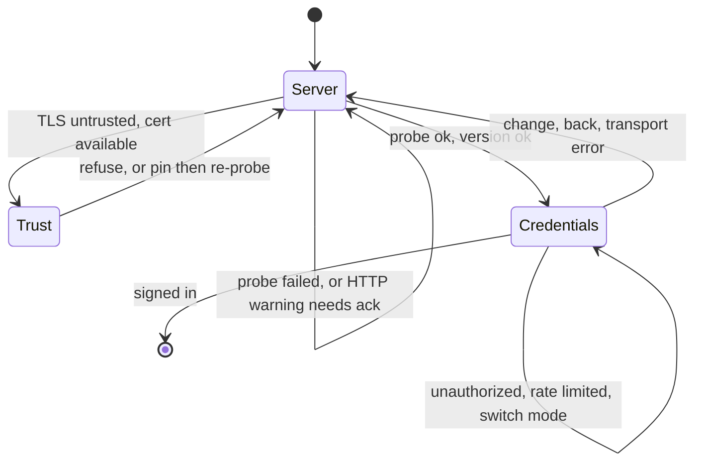

# Mini Audiobookshelf Android - Connect rework

## Goal Capsule

- **Objective:** Turn Connect into two steps with one primary action each: resolve a server, then sign in with one explicitly chosen credential. A rejected password keeps the form. The credential step is bound to the server the probe resolved. Returning users land on the credential step without retyping or re-tapping anything.
- **Authority hierarchy:** Phase 002 requirements R1 to R15 still hold on product behavior, in particular the version floor, HTTP acknowledgment, TLS pin, and no plaintext secret. This plan changes flow and state shape, not the security contract. KTDs here win on mechanism over the current `ConnectUi` shape.
- **Execution profile:** Step reducer and pure decisions in `:core` under JUnit first. `SessionController` adopts the sealed step second. `ConnectScreen` third. Scheme fallback, auto-probe, and remembered username last.
- **Stop conditions:** Stop and ask if trying `https://` then `http://` for a scheme-less host cannot be done without a second OkHttp client rebuild per attempt; if `BackHandler` on step 2 conflicts with the player sheet's back handling; or if remembering the username needs a new DataStore key namespace that phase 001 KTDs forbid.
- **Tail ownership:** Implementer owns build, test, commit.

Depends on [2026-09-01-002-feat-android-connect-auth-plan.md](2026-09-01-002-feat-android-connect-auth-plan.md). Touches phase 003's `onSessionExpired` return path.

---

## Product Contract

### Summary

Step 1 is the server. You type an address, press Go, and the app probes it. Plain HTTP and a self-signed certificate interrupt here, once, and then get out of the way. Step 2 is the credential. The screen shows which server you are signing into, offers Password or API key as a visible choice when the server supports both, and keeps the form on screen when the server says no. Coming back after sign-out or an expired session lands you on step 2 with your username filled in.

### Problem Frame

The current Connect screen is one scrolling column that grows as state arrives. It works, and it has five specific problems.

`SessionController.showConnectError` builds a fresh `ConnectUi` with no `offer`. `ConnectScreen` hides every credential field when `offer` is null. So a wrong password erases the form, and the user has to tap Continue to re-probe before trying again. One typo costs two extra round trips.

Username, password, and API key are all visible at once with one Sign in button. The app picks which to send by a rule the user cannot see. The rule was "API key wins" and was just flipped to "password wins". Either rule is a patch on the design.

The URL field stays editable after the probe. Editing it does not invalidate the offer. Sign in posts to whatever `rebuild` last produced, which is the old server.

Continue and Sign in are both on screen. Nothing responds to the keyboard's Go or Done action. The spinner floats mid-column.

`ServerUrl.parse` accepts `abs.lan:13378` with an empty scheme, `join` produces `abs.lan:13378/status`, OkHttp rejects that, and the user reads "could not be reached" for a server that is up.

Underneath all of it, `ConnectUi` is one flat struct. `offer`, `pin`, `showHttpWarning`, `httpAck`, `error`, and `busy` can combine in ways the screen has to defend against with `canTypeSecrets`. The states are really a small sequence, and the model should say so.

### Requirements

**Steps**

- R1. Connect is a sequence of steps: Server, Trust, Credentials. Exactly one is showing. Each has one primary action.
- R2. The Server step has a URL field, a Continue button, and an inline error under the field. The keyboard Go action triggers Continue.
- R3. The Credentials step shows the resolved origin and server version in a header with a Change action. There is no URL field on this step. Change returns to the Server step with the URL prefilled. System back does the same.
- R4. Sign-in requests go to the server the Credentials step was created for. There is no path from the Credentials step to a different origin without going through Server again.

**Choosing a credential**

- R5. When the server offers both local auth and API key, the Credentials step shows a two-way choice, Password and API key. Only the chosen mode's fields are shown. The chosen mode alone decides which sign-in call runs.
- R6. When the server offers only API key, the step shows the API key field and one line stating that the server uses single sign-on and an admin can issue a key. No choice control.
- R7. Password is the default when offered, unless the user last signed into this origin with an API key.
- R8. Sign in is disabled until the chosen mode's fields are non-blank. Password mode needs username and password. API key mode needs the key. The keyboard Done action on the last field submits when enabled.

**Failure stays on the form**

- R9. A rejected password or API key keeps the Credentials step. The error appears under the fields. Username and the chosen mode are kept. The password field is cleared and refocused. The API key field is kept.
- R10. A 429 keeps the Credentials step, shows the rate-limit message, and disables Sign in. It does not send the user back to Server. Phase 002 R8 still forbids automatic retry.
- R11. Transport failures during sign-in (unreachable, TLS) return to the Server step with the error, because the server is the thing that changed.

**Trust interruptions**

- R12. Plain HTTP: the Server step shows the phase 002 R4 warning and checkbox inline. Continue is disabled until the box is checked. Once acknowledged for that origin, the warning does not return on the same step visit. The scheme is never rewritten.
- R13. Untrusted TLS: the Trust step is the pin dialog from phase 002 R5, over the Server step. Pin re-probes and proceeds. Refuse returns to Server with the error.

**Addresses**

- R14. A scheme-less address tries `https://` first. If that fails with a transport error or TLS error, it tries `http://`, which routes into R12. A typed scheme is used as typed and never changed. The URL shown on the Credentials header is the scheme that worked.
- R15. The URL the user typed is what the Server step shows on return. The normalized origin is what is stored and probed.

**Returning**

- R16. When Connect opens with a stored server URL (after sign-out, after an expired session, after a failed restore), the app probes it without a tap and lands on Credentials if the probe succeeds. If it fails, the Server step shows with the URL and the error.
- R17. The Credentials step shows a one-line reason when there is one: "Your session expired. Sign in again." after `onSessionExpired`, nothing after a plain sign-out or first run.
- R18. The last username and last auth mode per origin are remembered in `SettingsStore`. They are not secrets. They prefill the Credentials step. The password and API key are never prefilled.

**Unchanged**

- R19. Phase 002 R6 to R15 hold: refresh token not password, proactive single-flight refresh, headers only, redaction, Keystore, degraded toast, restore, sign-out, logout-on-server.

### Acceptance Examples

- AE1. Wrong password twice
  - **Covers:** R9, R4
  - **Given:** the Credentials step is up for `https://abs.example.com`.
  - **When:** the user submits a wrong password, then a right one, without touching anything else.
  - **Then:** after the first submit the form is still there with username kept and password empty. After the second, the app is signed in. `/status` was called once.

- AE2. Both auth methods
  - **Covers:** R5, R7, R8
  - **Given:** `/status` lists `local`.
  - **When:** the Credentials step appears.
  - **Then:** Password is selected. Username and password fields show. The API key field does not. Sign in is disabled until both are filled. Switching to API key hides the password fields and shows the key field.

- AE3. SSO-only
  - **Covers:** R6
  - **Given:** `/status` lists only `openid`.
  - **When:** the Credentials step appears.
  - **Then:** there is no Password / API key choice. The key field and the SSO line are there.

- AE4. Scheme-less LAN box
  - **Covers:** R14, R12
  - **Given:** the user types `abs.lan:13378`, which only speaks HTTP.
  - **When:** they press Go.
  - **Then:** the app tries `https://abs.lan:13378/status`, fails, tries `http://abs.lan:13378/status`, gets a response, and shows the HTTP warning with the URL still `http://abs.lan:13378`. After acknowledging, Credentials shows `http://abs.lan:13378` in the header.

- AE5. Typed scheme is final
  - **Covers:** R14
  - **Given:** the user types `https://abs.lan:13378` and the server only speaks HTTP.
  - **When:** they press Go.
  - **Then:** the app does not try `http://`. The Server step shows an error.

- AE6. Session expired mid-browse
  - **Covers:** R16, R17, R18
  - **Given:** signed in with a password, the refresh token is revoked server-side, last username `alice`.
  - **When:** an authorized call returns 401.
  - **Then:** Connect opens, probes the stored URL without a tap, and shows Credentials with the session-expired line, Password selected, `alice` filled, password empty.

- AE7. Change server
  - **Covers:** R3, R4
  - **Given:** Credentials is up for server A.
  - **When:** the user taps Change, types server B, presses Go, and signs in.
  - **Then:** login goes to B. Nothing from A's `ApiClient` is used.

- AE8. Rate limited
  - **Covers:** R10
  - **Given:** `/login` returns 429.
  - **When:** the app observes it.
  - **Then:** Credentials stays up, the rate-limit message is under the fields, Sign in is disabled. Tapping Change still works.

- AE9. Back from Credentials
  - **Covers:** R3
  - **Given:** Credentials is up.
  - **When:** the user presses system back.
  - **Then:** the Server step shows with the URL. A second back leaves the app as before.

### Scope Boundaries

**In scope**

Sealed step model, step reducer in `:core`, `SessionController` migration, two-step `ConnectScreen`, mode choice, keep-form-on-error, keyboard actions, scheme fallback, auto-probe on return, session-expired reason, remembered username and mode, tests.

**Deferred**

OIDC in a Custom Tab. Multiple saved servers. A live rate-limit countdown. Biometric unlock of a stored password (we do not store the password). Autofill hints beyond `AutofillType.Username` and `Password`.

**Outside**

Any change to token storage, refresh, pin storage, or the HTTP contract. Disabling TLS verification. Upgrading or downgrading a typed scheme.

---

## Planning Contract

### Threat Model delta

Nothing new travels or is stored except the last username and last auth mode per origin in DataStore. Username is already visible to anyone who can read the DataStore file, because the server URL is there. It is not a secret and the phase 002 threat model does not treat it as one.

The scheme fallback adds one cleartext `GET /status` attempt for scheme-less input when HTTPS fails. No credential is on that request. The HTTP warning still gates every secret, per phase 002 R4. A typed `https://` is never downgraded, so a user who asked for TLS cannot be tricked onto cleartext by a blocked port.

Binding Credentials to the probed `ServerUrl` closes the case where a user edits the URL after the probe and posts credentials to the earlier host.

### Key Technical Decisions

- KTD1. **`ConnectStep` is a sealed class, and the reducer that moves between steps lives in `:core`.** Governs R1, R4, R9 to R11. `ConnectStep.Server(url, busy, error, httpWarning, httpAck)`, `ConnectStep.Trust(server: Server, pin: PinPrompt)`, `ConnectStep.Credentials(server: ServerUrl, version, offer, mode, username, reason, busy, error, rateLimited)`. A pure `ConnectFlow` object in `:core` takes a step plus an event (`ProbeOk`, `ProbeFailed`, `TlsUntrusted`, `SignInFailed`, `ChangeServer`, `SwitchMode`) and returns the next step. `SessionController` does the IO and feeds events. JUnit covers the reducer, so "wrong password keeps the form" is a test, not a hope.

- KTD2. **The `ApiClient` and `CredentialManager` are built once per successful probe and captured by the Credentials step.** Governs R4. `SessionController` keeps `api` and `credentials` as it does now, but `signIn*` checks that `currentStep is Credentials` and that its `server.origin == server?.origin`. Change and back null the offer path by moving to `Server`; a later probe rebuilds.

- KTD3. **Mode is explicit state, not inferred from field contents.** Governs R5 to R8. `AuthMode { PASSWORD, API_KEY }` on the step. `ViewLogic.defaultAuthMode(offer, remembered)` and `ViewLogic.canSubmit(mode, username, password, apiKey)` are pure and tested. The `password.isNotEmpty() || key.isEmpty()` branch in `ConnectScreen` is deleted.

- KTD4. **Scheme fallback is a decision list, not a loop in the transport.** Governs R14. `ViewLogic.probeCandidates(input): List<ServerUrl>` returns `[https, http]` for scheme-less input and `[typed]` otherwise. `probeInternal` walks the list, and only transport and TLS errors advance to the next candidate. `TooOld`, `NotFound`, and `Server` errors stop, because the host answered. Each candidate is a `rebuild`; that is one OkHttp client rebuild per attempt, which is what already happens on every Continue today.

- KTD5. **Auto-probe is a controller decision on entering Connect, keyed on a non-empty stored URL.** Governs R16. `start()` failed restore, `confirmSignOut()`, and `onSessionExpired` all end in `enterConnect(reason)`. If `settings.getServerUrl()` is non-empty, `enterConnect` sets `Server(busy = true)` and launches `probe`. The HTTP acknowledgment for that origin is already in DataStore, so a known HTTP server does not re-show the checkbox on this path. Auto-probe never runs against a URL the user has not previously connected to.

- KTD6. **Trust is a step wrapping Server, not a nullable field.** Governs R13. `Trust` holds the `Server` it interrupted. Pin returns to that `Server` with `busy = true` and re-probes. Refuse returns to it with the TLS error. The dialog composable reads `Trust` and nothing else.

- KTD7. **Username and mode per origin in `SettingsStore`.** Governs R7, R18. `getLastUsername(origin)`, `setLastUsername(origin, value)`, `getLastAuthMode(origin)`, `setLastAuthMode(origin, mode)`. Written on successful sign-in. Cleared on sign-out? No. Kept, because the whole point is the return path. Cleared only when the user signs into that origin as someone else, which overwrites.

- KTD8. **Errors from sign-in are classified into stay-or-leave.** Governs R9 to R11. `Unauthorized` and `RateLimited` stay on Credentials. `Tls`, `InvalidUrl`, and unknown exceptions go to Server. `ServerTooOld` cannot happen after a probe and is treated as leave. This classification is a pure function next to `classifyApiError`.

### High-Level Technical Design



`ConnectScreen` becomes a `when (step)`. `ServerStep` and `CredentialsStep` are separate composables with their own `rememberSaveable` field state keyed on the step's origin, so switching servers does not carry a password across. `TrustDialog` renders over `ServerStep`.

`SessionState.Connect(step: ConnectStep)` replaces `SessionState.Connect(ui: ConnectUi)`. `AppRoot` and Android Auto's signed-out branch only check `is Connect` and do not read fields, so they do not change.

### Output Structure

```text
core/.../ConnectFlow.kt          # ConnectStep, AuthMode, ConnectEvent, reducer
core/.../ViewLogic.kt            # defaultAuthMode, canSubmit, probeCandidates, signInFailureStays
core/.../SettingsStore.kt        # lastUsername, lastAuthMode per origin
core/src/test/.../ConnectFlowTest.kt
core/src/test/.../ViewLogicTest.kt
app/.../session/SessionController.kt   # feeds events, enterConnect, candidate walk
app/.../ui/connect/ConnectScreen.kt    # when(step)
app/.../ui/connect/ServerStep.kt
app/.../ui/connect/CredentialsStep.kt
app/.../ui/connect/TrustDialog.kt
app/.../res/values/strings.xml         # change_server, use_password, use_api_key, sso_only_hint, session_expired
```

### Assumptions

- `ServerUrl.parse` keeps accepting scheme-less input; KTD4 builds candidates from it rather than changing the parser's contract.
- The HTTP acknowledgment stored per origin is still the source of truth for R12 on repeat visits.
- No other screen reads `ConnectUi` fields. Verified for `AppRoot`, `SignedInScreen`, and the Auto callback at planning time; re-check at U3.

---

## Implementation Units

### Unit Index

| U-ID | Title | Key files | Depends on |
|---|---|---|---|
| U1 | Step model, reducer, pure decisions | `ConnectFlow.kt`, `ViewLogic.kt`, tests | none |
| U2 | Settings for username and mode | `SettingsStore.kt`, DataStore impl | none |
| U3 | Controller migration | `SessionController.kt` | U1, U2 |
| U4 | Two-step screen | `ConnectScreen.kt`, `ServerStep.kt`, `CredentialsStep.kt`, `TrustDialog.kt`, strings | U3 |
| U5 | Scheme fallback | `ViewLogic.probeCandidates`, `probeInternal` | U3 |
| U6 | Return path | `enterConnect`, `onSessionExpired`, reason line | U3, U4 |

U1 and U2 can run in parallel. U5 and U6 can run in parallel after U4.

### U1. Step model, reducer, pure decisions

- **Goal:** Every transition in the state diagram is a tested function.
- **Requirements:** R1, R4, R5 to R11
- **Approach:** Define `ConnectStep`, `AuthMode`, `ConnectEvent`, and `ConnectFlow.reduce(step, event)`. Add `defaultAuthMode`, `canSubmit`, `signInFailureStays` to `ViewLogic`.
- **Test scenarios:** unauthorized keeps Credentials with password cleared and username kept; rate limited keeps Credentials with `rateLimited = true`; TLS during sign-in goes to Server; SwitchMode keeps username; ChangeServer returns Server with the typed URL; default mode is Password when offered and no memory, API key when remembered, API key when local is absent; canSubmit matrix.

### U2. Settings for username and mode

- **Goal:** Remember who signed in where.
- **Requirements:** R7, R18
- **Approach:** Four methods on `SettingsStore` keyed by origin. `InMemorySettingsStore` for tests. DataStore keys `last_username.<origin>` and `last_auth_mode.<origin>`, matching how HTTP acknowledgment is already keyed.
- **Verification:** `:core:test` round-trip on the in-memory store. Emulator: sign in, kill, relaunch, sign out, username is prefilled.

### U3. Controller migration

- **Goal:** `SessionController` stops building `ConnectUi` and starts feeding events.
- **Requirements:** R4, R9 to R11, R13
- **Approach:** Replace `ConnectUi` with `ConnectStep` in `SessionState.Connect`. `probeInternal` emits `ProbeOk(server, version, offer)`, `ProbeFailed`, `TlsUntrusted(pin)`. `signInPassword` and `signInApiKey` guard on the current Credentials step's origin, emit `SignInFailed(failure)` on error, write U2 settings on success. `showConnectError` goes away. `pinCertificate` and `refusePin` operate on `Trust`.
- **Verification:** Build. Existing manual flows still work before U4 lands by keeping the current screen reading the new model minimally, or land U3 and U4 in one commit.

### U4. Two-step screen

- **Goal:** One step visible, one primary action.
- **Requirements:** R2, R3, R5, R6, R8, R9, R12, R13
- **Approach:** `ServerStep`: URL field with `ImeAction.Go` and `KeyboardActions(onGo = probe)`, inline `supportingText` error, HTTP card with checkbox, Continue disabled while unchecked or blank. `CredentialsStep`: header with origin, version, and Change; `SingleChoiceSegmentedButtonRow` for Password / API key when both offered; fields for the chosen mode; `ImeAction.Done` submits when `canSubmit`; error as `supportingText` under the last field; `LaunchedEffect(step.error)` clears and refocuses password on unauthorized. `BackHandler` on Credentials emits `ChangeServer`. `TrustDialog` reads `Trust`. Field state is `rememberSaveable` keyed on origin.
- **Verification:** AE1, AE2, AE3, AE7, AE8, AE9 by hand against a real server and an SSO-only fixture (a fake `/status` is enough).

### U5. Scheme fallback

- **Goal:** `abs.lan:13378` works.
- **Requirements:** R14, R15
- **Approach:** `ViewLogic.probeCandidates(input)`. `probeInternal` iterates. Transport and TLS errors advance; TLS on the last candidate becomes the Trust step; anything that proves the host answered stops. The typed text stays in `Server.url`; the winning `ServerUrl` goes to Credentials.
- **Test scenarios:** scheme-less gives `[https, http]` in that order; typed https gives one; typed http gives one; trailing slash stripped on both.
- **Verification:** AE4, AE5 against a local HTTP-only server.

### U6. Return path

- **Goal:** No cold start on the way back.
- **Requirements:** R16, R17
- **Approach:** `enterConnect(reason: ConnectReason)` with `NONE`, `SIGNED_OUT`, `SESSION_EXPIRED`, `RESTORE_FAILED`. `start()`, `confirmSignOut()`, and `onSessionExpired` call it. Non-empty stored URL means `Server(busy = true)` plus `probe`. `Credentials.reason` renders the R17 line. `onSessionExpired` currently routes through `confirmSignOut()`, which also posts `/logout` with a dead token and clears last-played fields; keep the local clear, skip the server logout when the trigger was a 401, and do not clear last-played ids since the user is coming right back.
- **Verification:** AE6. Also: sign out, watch Credentials appear without a tap; airplane mode, sign out, watch Server appear with the unreachable error and the URL intact.

---

## Verification Contract

Phase done when: a wrong password can be corrected without re-probing; the credential mode is a visible choice and the only thing that decides the request; the URL cannot be edited on the credential step; `abs.lan:13378` reaches an HTTP-only server through the warning; sign-out and expiry both return to a filled-in credential step with a reason line when there is one; `:core:test` covers the reducer, mode default, submit gate, and candidate list; and every phase 002 acceptance example still passes by hand.

---

## Risks and Dependencies

| Risk | Impact | Mitigation |
|---|---|---|
| Auto-probe on every sign-out | One extra request, spinner flash | Only when a stored URL exists; it was going to be tapped anyway |
| Scheme fallback hits cleartext | One unauthenticated `GET /status` over HTTP | No secret on it; warning still gates secrets; typed https never falls back |
| `BackHandler` ordering with player sheet | Back closes the wrong thing | Connect is only shown when not signed in; the sheet is not composed then. Verify at U4 |
| Field state survives server change | Password typed for A shown for B | `rememberSaveable` keyed on origin |
| `SessionState.Connect` shape change | Other readers break | Only `ConnectScreen` reads the payload today; grep at U3 |
| Remembered username surprises shared devices | Someone sees the last account name | It is the same exposure as the server URL; clear on Change if that feels wrong, see OQ2 |

**Dependencies:** phase 002 credential manager and transport unchanged. Material3 `SegmentedButton` is in the current Compose BOM.

---

## Open Questions

- OQ1. Segmented Password / API key versus password-first with a "Use an API key instead" link. Default: segmented. Both options are visible at a glance, and SSO-only servers simply omit the control.
- OQ2. Clear the remembered username when the user taps Change. Default: no. Per-origin memory means server B has its own slot.
- OQ3. Skip the HTTPS attempt for `localhost`, `127.0.0.1`, and RFC 1918 hosts in the candidate list. Default: no. One failed TLS attempt is cheap and the rule would be a surprise the first time it is wrong.
- OQ4. Focus the password field automatically when Credentials appears with a remembered username. Default: yes.

---

## Sources and Research

- Phase 002 plan, R1 to R15, KTD5, state diagram. This plan keeps that state machine and changes only the UI steps around it.
- Current `SessionController.showConnectError` and `ConnectScreen` `canTypeSecrets` gate, which together cause the form to vanish on a rejected password.
- `ServerUrl.parse` scheme-less branch and `ApiClient.send` `server.join`, which together produce a URL OkHttp rejects.
- Material3 `SingleChoiceSegmentedButtonRow`, Compose `BackHandler`, `KeyboardActions` for `ImeAction.Go` and `ImeAction.Done`.
